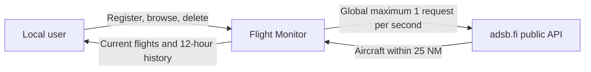
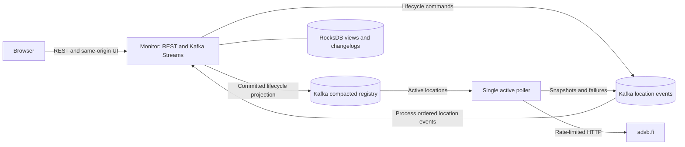
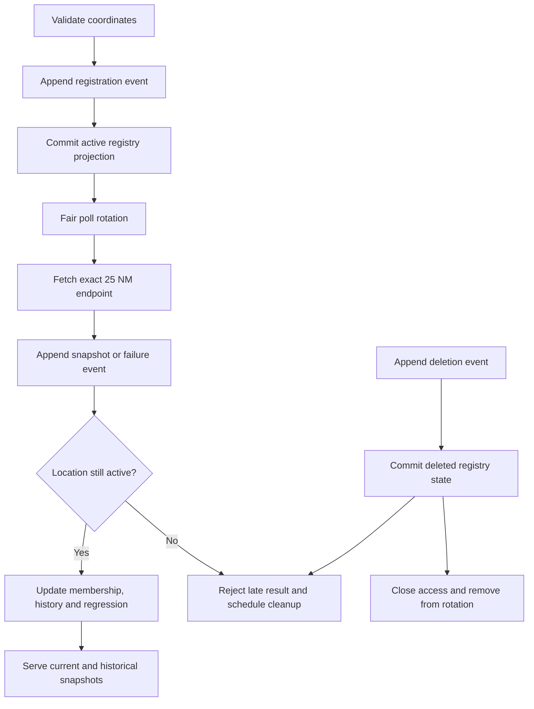
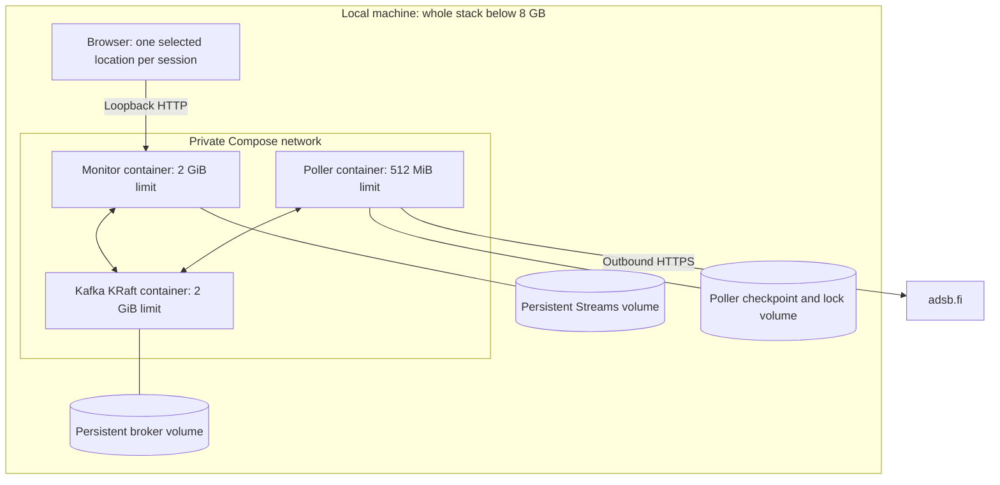
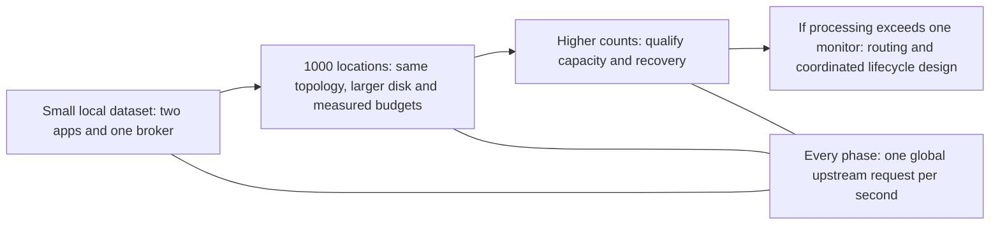
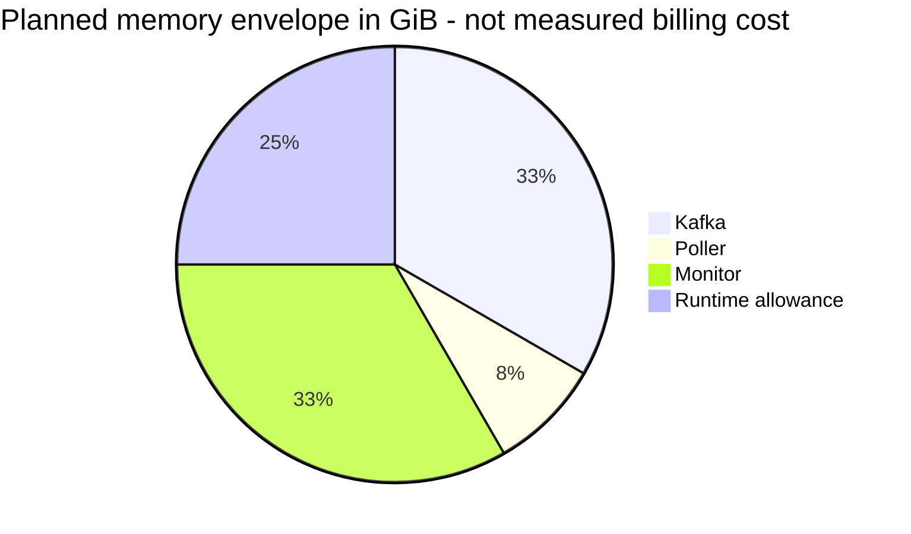

# Stream Flight Monitor - Architecture Plan

Status: detailed plan approved on 2026-11-06; implementation task approval pending (Checkpoint C).
Date: 2026-11-06.
Audience: project owner and implementing developers.
Document type: architecture explanation and design reference.

## Executive summary

Use one dedicated Java poller, one combined REST/web and Kafka Streams application, and one persistent local Kafka broker. All locations share a fair rotation and a single upstream request budget. Active locations expose current aircraft and a rolling 12-hour snapshot history. Deletion immediately closes application access once acknowledged and asynchronously removes historical data. The whole stack must use less than 8 GB, including the container runtime allowance. This is a design, not an implemented or benchmarked system.

## Discovery summary

### Confirmed requirements

- Register finite latitude [-90, 90] and longitude [-180, 180]; return a locationId.
- Query exactly `https://opendata.adsb.fi/api/v3/lat/<lat>/lon/<lon>/dist/25`.
- Monitor aircraft within 25 nautical miles; all registered locations receive equal polling opportunities.
- Globally allow no more than one upstream request start per second, including failed attempts.
- Display aircraft ID, flight number where available, speed, altitude, and status.
- Regress at least five consecutive valid observations of the same aircraft within a location.
- Show COLLECTING_DATA before enough observations exist.
- Increasing data age with location count is accepted.
- Browse snapshots for active locations up to 12 hours in the past.
- Delete a location and its entire history; asynchronous physical cleanup is acceptable.
- Only one location is selected per browser session.
- Run locally, below 8 GB for the whole stack; prefer Java and Kafka.
- Cloud deployment and paid subscriptions are excluded.

### Proposed defaults requiring plan approval

| Decision | Proposal |
|---|---|
| Initial capacity target | 1,000 active locations; qualify higher counts using the same validation |
| Classification | Five valid samples; level-flight tolerance +/-100 feet/minute |
| Sample continuity | Reset on disappearance, invalid altitude, failed poll, or observation gap exceeding three expected cycles |
| History timestamp | Poll completion time in UTC, assigned once by the poller |
| History browse limit | Rolling 12 hours; 100 snapshots/page, maximum 200 |
| Source freshness | Show source observation age separately from polling age; reject samples older than the expected cycle plus 60 seconds |
| Access | Local trusted-user application, bound to loopback; no Internet exposure |
| Cleanup objective | Local views within 60 seconds of processing deletion; physical Kafka cleanup target 48 hours under healthy operation, monitored, not a hard erasure deadline |
| Broker durability | One broker, replication factor 1, persistent disk; no disk-loss tolerance |

Expected cycle means `max(active-location-count seconds, most recent completed cycle duration)`. During startup use the location count estimate and display freshness as estimated. These policies must be configurable through validated typed configuration and documented, not hidden heuristics.

## Architecture style

| Option | Benefits | Trade-offs |
|---|---|---|
| Single application plus Kafka | Fewer processes and lower overhead | HTTP ingestion, processing, and user access share a failure boundary |
| **Dedicated poller plus combined monitor (approved)** | Source failures isolated; one clear owner of the rate limit | Additional JVM, asynchronous lifecycle propagation |
| Custom Kafka Connect source | Connect lifecycle and integration conventions | Custom scheduling still needed; extra runtime and coordination |
| No Kafka initially | Smallest footprint | Weaker ecosystem fit; different recovery/replay design |

Use event-driven communication between two deliberately coarse components. Do not split further without measured need. Kafka Connect, Redis, a separate database server, and orchestration platforms are unnecessary initially.

## Technology stack

There are no existing manifests or version constraints. These are candidate version lines, not verified compatibility or security claims. Pin exact supported patches and validate the dependency tree before implementation.

| Layer | Primary candidate | Alternative and trade-off |
|---|---|---|
| Java | Java 21 LTS | Java 25 LTS: newer baseline, requires compatibility verification |
| Application | Spring Boot 3.5.x, dependency-managed Spring Kafka/Streams | Plain Java HTTP server: smaller framework footprint, more lifecycle work |
| Broker | Apache Kafka 3.9.x, single-node KRaft | Newer supported Kafka line after client/broker verification |
| State and history | Kafka Streams persistent RocksDB stores and changelogs | Embedded SQL database: easier history queries, additional write/offset consistency design |
| UI | Same-origin HTML and small vanilla JavaScript client | Frontend framework: more build/runtime complexity than needed |
| Build | Maven multi-module with wrapper | Gradle: viable, no established preference |
| Local deployment | Docker Compose, persistent named volumes | Native Java services: less container overhead, more manual setup |
| Tests | JUnit, Streams TopologyTestDriver, integration tests against real Kafka and a local HTTP stub | Mock-only tests are insufficient for recovery and serialization |
| Observability | Actuator/Micrometer and structured logs | Optional metrics server later; exclude it from the initial memory budget |

### Evaluation matrix

Scores: 1 poor, 5 strong; provisional qualitative evaluation, not benchmarks.

| Criterion | Weight | Proposed Java/Kafka stack | Smaller non-Kafka application |
|---|---|---:|---:|
| Team fit | High | 5 (stated preference, expertise unconfirmed) | 3 |
| Ecosystem maturity | High | 5 | 5 |
| Scalability | High | 4 (source remains limiting) | 3 |
| Ownership cost | Medium | 3 | 5 |
| Hiring familiarity | Medium | 4 | 4 |
| Local resource efficiency | Medium | 3 | 5 |
| Security posture | Medium | 3 (patch review pending) | 3 |
| Portability | Low-medium | 5 | 5 |

No cache server, search service, or external frontend hosting is needed.

## System architecture

[Interactive diagrams](./stream-flight-monitor-architecture-diagrams.html) |
[Editable Draw.io diagrams](./stream-flight-monitor-architecture.drawio)

### System context

### Components

### Data flow

### Deployment

## API and browser contracts

Paths and response fields below are proposed public contracts; freeze them before implementation.

| Operation | Contract |
|---|---|
| Register | `POST /api/locations`, JSON latitude/longitude; 201 with locationId, trackingUrl, createdAt, state=WAITING_FOR_FIRST_POLL |
| Current | `GET /api/locations/{locationId}`; lifecycle, last attempt/success, expected cycle, age, health, latest aircraft |
| History index | `GET /api/locations/{locationId}/snapshots?from=...&to=...&limit=100&cursor=...` |
| Snapshot detail | `GET /api/locations/{locationId}/snapshots/{snapshotId}` |
| Delete | `DELETE /api/locations/{locationId}`; 202 after durable deletion and committed serving gate, cleanupPending=true |
| UI | `/locations/{locationId}`; registration form, current listing, timeline and deletion action |

- Enforce JSON body limits, finite numeric coordinates, UTC timestamps, maximum page size, bounded cursor length, and cursor binding to location/time filters.
- Reject requested history outside the retained 12-hour range with 400 and a clear error; default to the retained range.
- Unknown IDs return 404; known deleted IDs return 410. Repeat deletion of a known deleted ID is idempotent.
- Invalid input returns 400, admission capacity exhausted 409, store restoration/unavailable Kafka 503. Use structured problem responses; never return an empty success for a storage failure.
- Registration/deletion wait at most 10 seconds for their eventId in the committed lifecycle projection. A timeout is 503 with operationId and an explicit "outcome not yet confirmed" message, not a claim that the write was rolled back.
- Support an Idempotency-Key for registration retries, with a durable bounded 24-hour deduplication index. A repeated key with different coordinates is 409.
- Require the registration form/client to generate that key before sending. Derive a stable opaque locationId from the deployment namespace and key so concurrent retries route to the same event partition; compare the coordinate fingerprint in the processor. Reusing an expired key is unsupported and must not recreate a deleted ID.
- An operation lookup endpoint (`GET /api/operations/{operationId}`) resolves uncertain writes; retain operation results for 24 hours.
- The UI polls its selected location every 5 seconds; this does not trigger upstream requests. Use sessionStorage for one selected ID per browser tab session; this is a UI rule, not authorization.
- Aircraft output: Mode-S hex ID, optional registration, optional callsign, flightNumber nullable, speedKnots, altitudeFeet nullable, status, observedAt, age, and quality flags. Show unavailable values explicitly.
- Do not relabel an unverified callsign as a commercial flight number. Without a verified upstream mapping, display callsign separately and flight number as unavailable.
- History detail freezes the classification and data quality at capture; it is not recalculated with future observations.

## Fair ingestion and global rate limiting

1. Reconstruct the active registry to startup high-water marks using read_committed before polling.
2. Maintain a circular, insertion-ordered rotation; snapshot membership at cycle boundaries. Newly active locations enter the next cycle, and deletion removes remaining turns immediately when learned.
3. Use a single request thread, one request in flight, a monotonic clock, and at least 1,000 ms between request starts. Do not accumulate tokens or issue catch-up bursts.
4. Configure connect timeout 3 seconds, total request timeout 10 seconds, and a bounded response size. Disable automatic HTTP retries and redirects; every source request must pass the limiter.
5. Advance the turn after any outcome. Timeouts, 429 and 5xx are explicit poll failures; no immediate per-location retry. Honor Retry-After by pausing the global scheduler, then resume the rotation without bursts.
6. On 401/403 or incompatible response schema, pause globally and expose an actionable error instead of repeating invalid requests forever.
7. Publish the outcome durably before advancing its checkpoint. On Kafka failure, hold at most one bounded result and stop new requests; expose unhealthy status and resume through reconciliation.
8. Use a persistent OS-level exclusive lock for the one configured poller state directory. A second process using that deployment directory fails startup. Independent deployments on the same public IP remain an external operational constraint: they must not run concurrently.
9. After restart wait at least one full second before any request; persist any provider-wide cooldown using UTC and conservatively honor it. Do not support overlapping automatic failover.

Checkpoint records contain rotation position, cycle membership version, last completed requestId and source cooldown. Crash between HTTP completion and durable publication can lose that observation or repeat a later fetch. requestId makes publication retries idempotent, not HTTP exactly-once.

For N stable locations, minimum cycle duration is N seconds, excluding latency/backoff. At N=1,000, five samples span at least 66 minutes 40 seconds after the first sample. Many aircraft will never collect five samples within the radius; COLLECTING_DATA can be the correct persistent outcome.

## Kafka contracts and state

### Topics

| Topic | Key | Policy | Purpose |
|---|---|---|---|
| `flight.location-events.v1` | locationId | delete, 13-hour minimum retention | REGISTER, DELETE, SNAPSHOT, POLL_FAILED, and operation commands |
| `flight.location-registry.v1` | locationId | compact; retain latest terminal lifecycle records | Authoritative committed lifecycle projection for poller and serving gate |
| `flight.poller-checkpoint.v1` | poller deployment ID | compact | Rotation recovery and cooldown |
| Streams changelogs | Store-specific stable keys | compact, with tombstones | Reconstruct registry, histories, windows and operation results |

Start the event and registry topics at three partitions with matching location-key serialization; replication factor 1. Do not change partition counts casually: doing so can reorder a location's lifecycle relative to its snapshots and requires a migration.

Envelope fields: schemaVersion, eventType, eventId, locationId, locationGeneration, emittedAt, and typed payload. A snapshot adds requestId, capturedAt, source time metadata, aircraft and quality metadata. A poll failure carries bounded error category and retry information, never a successful empty list.

The monitor uses a stable application.id and named stores/processors. Lifecycle and snapshots share the event topic, so their order is explicit within a location partition. Snapshots carry a generation and cannot reactivate a deleted lifecycle. Reusing deleted IDs is forbidden.

Registry records use ACTIVE or DELETED; do not tombstone a deleted identity immediately. Preserve a minimal deletion marker without coordinates to stop old events from resurrecting it. Deleted identity markers grow with lifetime registrations: apply a declared lifetime-capacity limit and monitor disk usage rather than pretending they expire safely.

Configure producer idempotence, acknowledgements=all, bounded delivery timeout and read_committed consumers. Streams exactly_once_v2 can atomically commit Kafka output, offsets and recoverable processing state. It does not cover HTTP fetching, browser responses, physical deletion or arbitrary interactive-query read isolation.

Malformed events stop the affected partition with a visible error and operator recovery procedure; no silent skip or broad exception catch. A quarantine-and-continue policy would require a separately approved data-loss policy.

### Stores and history queries

- Registry store: location lifecycle, generation and eventId.
- Latest store: location membership and most recent successful capture, plus last failure.
- History store: lexicographically sortable `(locationId, capturedAt, requestId)` keys and normalized snapshots with captured classification.
- Expiry index: `(expiresAt, locationId, requestId)` keys, enabling bounded wall-clock cleanup even when no new observations arrive.
- Trend store: `(locationId, aircraftId)` with at most five observations.
- Operation/idempotency stores: results and expiry indexes, retained 24 hours.

Only processor-owned code mutates stores. HTTP handlers use bounded read-only interactive queries; one monitor instance owns all partitions initially. Not-ready stores return 503. History scans are restricted to one location, a 12-hour interval and one page; do not scan all locations or load complete histories in heap.

History expires at capturedAt + 12 hours. Public queries also apply this cutoff immediately, independent of cleanup progress. Punctuation performs bounded deletion batches and yields between batches. Iterator and request lifetimes are bounded and closed.

A committed registry consumer in the monitor provides the serving gate: REGISTER/DELETE API acknowledgement waits until that consumer observes the eventId. Every current/history response rechecks this gate before release. Local interactive-query state may be ahead of committed processing; do not advertise linearizable snapshot reads. Frozen snapshot IDs and duplicate-safe updates prevent duplicate history entries on replay.

## Snapshot correctness and classification

Successful snapshots replace current membership; an empty success clears it. Failure preserves the last-known list but marks it stale and resets trend continuity before the next classification.

Verify aircraft position is finite and within 25 nautical miles using spherical distance (including antimeridian handling). Missing positions are excluded with a visible quality count. Do not interpolate absent aircraft into historical snapshots.

Map and test upstream fields against the supplied API documentation and captured synthetic fixtures before implementation. Preserve source observation timestamps when available; derive them from source response time and aircraft age only if the schema supports that interpretation.

For each location/aircraft:

1. Identify using normalized Mode-S hex, not callsign.
2. Require finite numeric altitude in feet; ground/missing altitude yields COLLECTING_DATA with a reason, never zero.
3. Discard repeated or older source observations from regression, recording a bounded quality counter.
4. Reset the window after absence, failed poll, invalid altitude, or an excessive time gap. A duplicate does not add a sample.
5. With five valid points, perform least-squares altitude versus elapsed minutes relative to the first point. Require distinct timestamps and nonzero time variance.
6. Slope below -100 ft/min gives LANDING; above +100 gives DEPARTURING; inclusive boundaries give FLYING.

The tolerance is a proposal, not a supplied requirement. Label these as altitude trends, not confirmed landing/departure intent. Aircraft speed is ground speed in knots if that is what the source supplies; do not claim airspeed.

## Deletion, retention and recovery

Deletion appends an ordered DELETE event. Processing writes the DELETED registry projection and schedules cleanup. After committed gate confirmation, the API returns 202; subsequent browsing is denied. A response already delivered before deletion cannot be retracted.

The poller removes the location after receiving that committed projection. One in-flight request may finish; its event is rejected by generation/lifecycle checks. Processing removes current data, regression state, history, expiry indexes, and coordinate-bearing idempotency payloads in bounded batches.

Physical copies exist in event segments, registry old versions, changelogs, RocksDB SST files and local volumes. Kafka time retention is not a precise per-record erase clock: segment rolling, retention checks, cleaner availability and tombstone retention matter. Configure bounded segment rolling, cleaner capacity and finite tombstone retention; force no unsafe manual segment deletion.

Set a provisional 48-hour healthy-operation cleanup objective, including compaction and local file reclamation, with overdue cleanup alerts. This is not a guaranteed cryptographic erase time. If a hard erasure deadline becomes mandatory, redesign storage. Backups are excluded initially; adding them requires an explicit deletion policy.

Retain the minimal non-coordinate deletion marker. "Entire history removed" means aircraft/location history and submitted coordinates, not forgetting the ID's deleted status.

### Restart and migration

- Poller restores the committed registry and checkpoint; it must not start with an incomplete registry.
- Monitor restores changelogs and gates reads until ready. Apply expiry and deletion before exposing recovered history.
- Loss of a single broker disk can lose registry and history; the initial stack is not highly available.
- Do not reset the Streams application.id and replay only the 13-hour source log: active registrations may be older than that. Normal recovery uses compacted registry/changelogs.
- A topology/store/schema migration requires a tested export/bootstrap of current lifecycle (including deleted markers), bounded history rebuild, stopped poller and API writes, validation, and a rollback backup with a deletion-aware disposal policy.
- Version envelopes compatibly; preserve unknown optional fields where appropriate, reject unsupported major schema versions. Document topic/store changes in an ADR before deployment.

## Scalability roadmap

Scale here means registered locations and local processing, not cloud users.

| Phase | Change and rationale | Cost and migration |
|---|---|---|
| MVP | Same two-service topology; small validation dataset | Lowest local footprint, persistent volumes from day one |
| Growth | Qualify 1,000 locations, disk retention and restoration | More disk/possibly CPU; no new services by default |
| Higher capacity | Measure state size, query latency, cycle duration and cleanup | Raise capacity only within validated resources; reject excess admissions explicitly |
| Beyond one monitor | Routing to partition owners or a separate query projection | New design approval needed; independent replicas cannot serve arbitrary local stores |

No multi-region, cloud or unrestricted multi-poller path is proposed. All phases retain equal-turn scheduling and expose increasing data age.

## Resource and cost analysis

### Memory budget

| Component | Hard container target | Notes |
|---|---:|---|
| Kafka KRaft | 2 GiB | Proposed heap 768 MiB; leave native/page-cache headroom |
| Poller | 512 MiB | Proposed heap 192 MiB, bounded response and queues |
| Monitor | 2 GiB | Proposed heap 768 MiB; explicitly budget shared RocksDB block cache/write buffers |
| Runtime/WSL allowance | 1.5 GiB | Measure actual overhead; host applications are outside the stack |
| **Total planning envelope** | **6 GiB = 6,442,450,944 bytes** | Below 8,000,000,000 bytes; not yet measured |

Container limits are not memory proof. Include native allocations, charged file cache and runtime overhead without double-counting. Validate steady state, query load, 12-hour retention, startup restoration and deletion. An OOM kill fails acceptance even if a configured limit is below the budget.

### Disk and capacity

At one successful request/second there can be at most 43,200 newly captured snapshots in a 12-hour window, regardless of location count. Failure events and registration commands add bytes; publication retries must deduplicate logical snapshots.

`history payload bytes <= 43,200 * average normalized snapshot bytes`

At 100 KiB average this is about 4.12 GiB before source retention, changelog, indexes, current views, compaction headroom and filesystem overhead. Provision initially from measured fixtures using a conservative total multiplier of six (about 25 GiB in that example), then verify it under load.

Propose a 4 MiB upstream body limit and a 1 MiB normalized snapshot/event limit with aligned Kafka producer, broker and consumer settings. An oversized result is an explicit failed poll, never silent truncation. Even a 1 MiB accepted snapshot every second means about 42.2 GiB of history payload and roughly 253 GiB with that multiplier. The average-case 25 GiB example is not a worst-case guarantee.

Choose the supported density profile and reserve disk before release. Enforce disk watermarks, registration limits and bounded request sizes; if capacity is exhausted, stop ingestion with an explicit degraded state rather than silently deleting history younger than 12 hours. Guarantee 12-hour browsing for accepted captures, not uninterrupted upstream availability.

### Local cost model

| Component | MVP | Growth | Higher capacity |
|---|---|---|---|
| Compute/RAM | Existing machine, budgeted above | Same topology, measure CPU | Hardware upgrade only if measurements require it |
| Storage | Fixture-derived reserve | 12-hour payload and compaction dominate | Density matters more than location count alone |
| Network | At most 86,400 public requests/day | Same request ceiling | Same request ceiling |
| API/software fees | No paid service assumed; terms apply | Same | Contact provider if requirements change |
| Electricity | watts / 1000 * hours * local tariff | Measure actual draw | Measure before hardware decisions |

No currency total is claimed without hardware, electricity tariff and disk prices. The top cost drivers are disk amplification, JVM/native memory, and always-on local power. Reuse existing hardware, avoid additional runtimes, and bound retention instead of speculative reserved-cloud pricing.

The resource allocation diagram is the available local cost proxy, not a fabricated monetary breakdown.

## Security architecture and observability

- Bind the browser-facing port to loopback; keep broker listeners and health/metrics endpoints off public interfaces.
- Treat the local operator as trusted. Opaque IDs are not authorization; shared-machine or remote-user access requires authentication and deletion authorization before enabling it.
- Allow only the fixed HTTPS source host/path template. Validate coordinates before URL construction; disable redirects to prevent host escape.
- Same-origin UI, no permissive CORS; validate Origin on mutations and use CSRF protection for browser form/session flows. No mutable GET endpoints.
- Escape upstream callsigns and metadata in the UI. Do not log coordinates, complete source payloads, or sensitive identifiers by default.
- Cite and link adsb.fi in the UI and project documentation. The supplied terms allow personal, non-commercial use only.
- Record bounded-category errors, request latency, request spacing violations, provider status class, cycle duration, capture age, consumer lag, store size, restoration duration, deletion backlog/oldest age, disk and memory use.
- Never use locationId, aircraftId or arbitrary exception messages as metric labels. Structured diagnostic correlation IDs belong in controlled logs, not cardinality-unbounded metrics.
- Alert on limiter violations, stalled rotations, repeated invalid-source requests, disk pressure, restoration failures and overdue deletion.

## Validation plan

No application tests or benchmarks have run; these are implementation acceptance gates.

| Requirement | Required validation |
|---|---|
| Valid registration | Coordinate boundaries, NaN/infinity, missing/string fields, body limits and idempotent retries |
| Global rate limit | Record monotonic request starts at the HTTP stub; every adjacent pair >=1,000 ms across locations, failures, retries, cooldowns and restart |
| Equal frequency | For stable membership and each completed cycle, exactly one attempt/location; test churn without restarting/starving existing rotation |
| Regression | Five points, tolerance boundaries, constant/ascending/descending, duplicates, out-of-order time, missing/ground altitude, gaps and numerical stability |
| 25 NM membership | Inside/outside boundary, antimeridian and missing positions; no cross-location history sharing |
| History | Frozen snapshot content, empty snapshots, exact 12-hour cutoff, stable pagination, duplicate publication and fake-clock expiry |
| Deletion | Immediate post-ack read rejection, late snapshot, restart/replay, bounded cleanup, no coordinate leakage in terminal markers |
| Kafka correctness | Real serialization, same-key lifecycle order, broker restart, transaction abort, Streams restoration and expired source log with retained registry |
| Failure semantics | Kafka unavailable, source timeout/429/403, malformed/oversized response, disk watermark; no success-shaped fallback |
| Whole-stack memory | 1,000-location representative-density workload covering a complete 12-hour history plus restart/restore and concurrent browse/delete; measured peak strictly <8,000,000,000 bytes |
| Browsing | Registration to tracking URL, single selected location per tab session, history browsing and deletion; negative unknown/deleted ID and rejected mutation |

Use fake clocks for scheduler/expiry unit tests, TopologyTestDriver for processing, and isolated real Kafka plus a local HTTP stub for integration tests. Do not load-test the public API or send user locations for test generation. Run the smallest relevant test set before broader integration and soak gates.

## File-level implementation plan

These are proposed files, not existing code links. Exact class boundaries can be adjusted during implementation without changing contracts.

| Proposed path | Responsibility |
|---|---|
| `pom.xml`, Maven wrapper | Java baseline, dependency management, modules and test plugins |
| `contracts/pom.xml`, `contracts/src/main/java/.../event/` | Typed versioned envelopes, lifecycle and snapshot schemas |
| `contracts/src/test/java/.../` | Serialization and compatibility fixtures |
| `monitor/pom.xml`, `monitor/src/main/java/.../MonitorApplication.java` | Combined web/processing lifecycle |
| `monitor/src/main/java/.../api/` | Validation, registration, operation lookup, current/history/deletion endpoints |
| `monitor/src/main/java/.../streams/` | Named topology, lifecycle projection, histories, trends and cleanup processors |
| `monitor/src/main/java/.../query/` | Readiness, committed lifecycle gate and paged store queries |
| `monitor/src/main/resources/static/` | Same-origin registration, current/history UI and attribution |
| `poller/pom.xml`, `poller/src/main/java/.../PollerApplication.java` | Dedicated ingestion lifecycle |
| `poller/src/main/java/.../schedule/` | Rotation, exclusive ownership, limiter, checkpoints and cooldowns |
| `poller/src/main/java/.../source/` | Bounded HTTPS client and validated upstream normalization |
| Both applications' configuration files | Typed properties, local profiles, resource limits and log categories |
| `compose.yaml`, container build files | One broker, two services, volumes, private network and memory limits |
| Module test directories and `integration-tests/` | Unit, topology, real Kafka/HTTP integration, UI flow and resource validation |
| `README.md`, `CHANGELOG.md` | Setup, contracts, recovery/deletion instructions and release record |

Implementation sequence after plan and task approval:

1. Pin compatible dependencies, establish modules, Compose and resource configuration.
2. Define event contracts, topic initialization and lifecycle state.
3. Implement API lifecycle and committed serving gate.
4. Implement fair poller, normalization and checkpoint recovery.
5. Implement snapshot/history/regression topology and bounded cleanup.
6. Implement current/history UI and operation feedback.
7. Add unit/topology coverage, then real integration and end-to-end gates.
8. Run capacity, 12-hour memory/disk soak, recovery and deletion validation; document measured limits.

## Risks and mitigations

| Risk | Owner | Mitigation |
|---|---|---|
| Most aircraft never yield five samples at high location count | Product owner | Accept COLLECTING_DATA; show actual freshness; do not fabricate status |
| Classification label implies intent | Product owner | Explain trend-only meaning; approve tolerance |
| Unbounded history/native memory | Processing owner | Five-point windows, expiry, bounded pages/caches and soak tests |
| Source limit violated by duplicate deployment | Ingestion/operator | Single configured deployment/lock; no overlapping failover |
| Physical deletion exceeds target | Operator | Cleaner/disk monitoring, cleanup backlog visibility; no strict erasure claim |
| Unverified field mapping/version choice | Implementation owner | Schema fixtures, dependency compatibility/security checks before coding |
| One broker disk loss | Operator | Explicit non-HA local deployment; deletion-aware backup policy if later required |
| Kafka-only history queries become cumbersome | Processing owner | Validate prefix query latency early; revisit embedded SQL only with evidence |

## Architecture decision records

- [ADR-001: Dedicated poller and local Kafka](./architecture/ADR-001-dedicated-poller.md)
- [ADR-002: Location history and asynchronous deletion](./architecture/ADR-002-history-and-deletion.md)

## Next steps

The detailed plan was approved on 2026-11-06 (Checkpoint B). Review the explicit implementation task list in the saved workflow context (Checkpoint C). No implementation begins before task approval.

## Sources and validation status

- Requirements and decisions: [saved workflow context](../development-flight-monitor.md).
- Provider reference supplied by user: https://github.com/adsbfi/opendata/blob/main/README.md (read during discovery).
- Provider attribution target: https://adsb.fi

The plan was authored in this session; no separate architect-agent tool was available. No application, deployment, dependency compatibility, rendered Mermaid output or resource threshold has been validated yet. Artifact checks are reported separately after file creation.

Artifact checks executed on 2026-11-06:

- All six standalone Mermaid sources match their Markdown and HTML counterparts.
- Draw.io XML parses, with three tabs, unique IDs per tab and valid labeled edge endpoints.
- All nine local Markdown/HTML document links resolve.
- Memory-envelope arithmetic confirms 6 GiB is below decimal 8 GB; this is not a measurement.
- Browser rendering and application/resource acceptance gates remain unexecuted.
